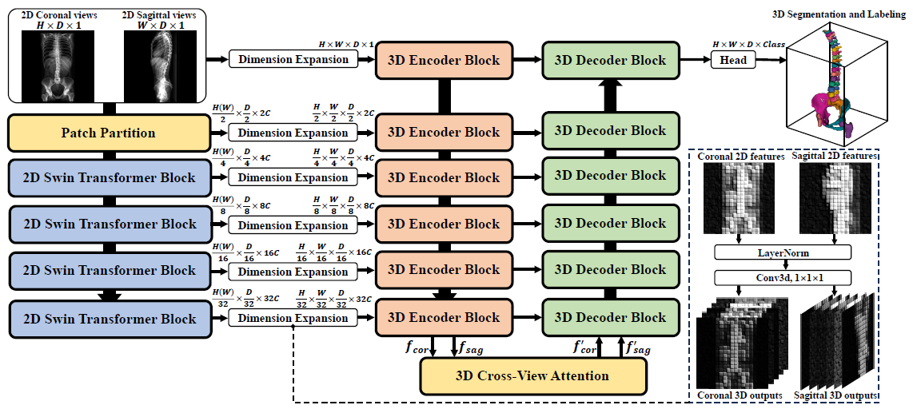
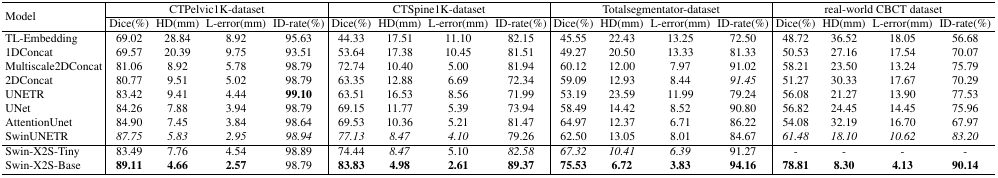
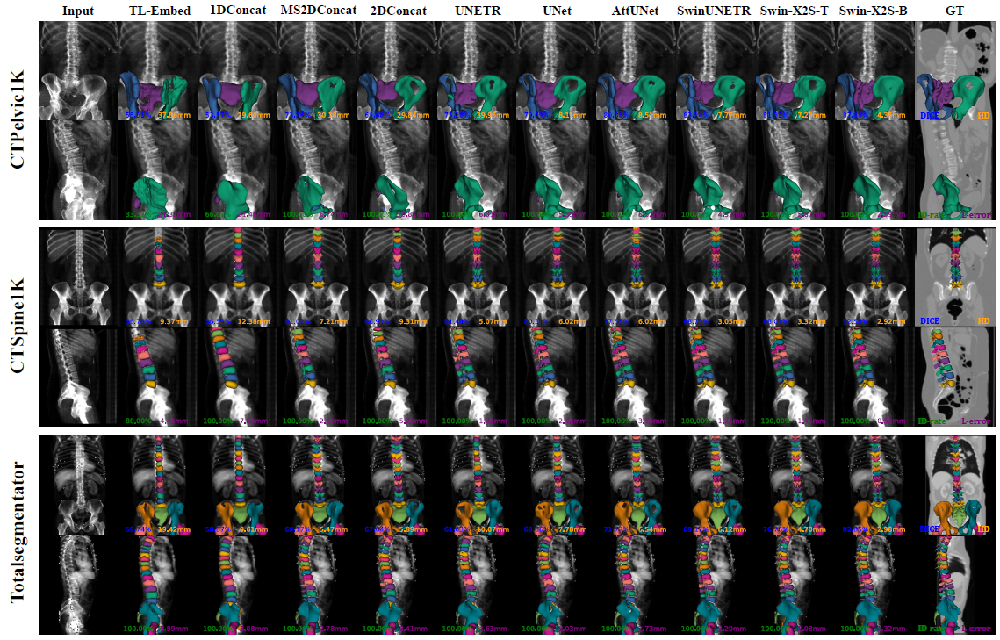
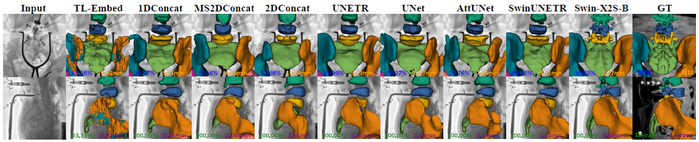

# Swin X2S: Reconstructing CT Segmentation and labeling from Multi-view X-ray with Swin Transformers
 by Kuan Liu et al.

## Introduction
This repository is the official implementation code for our paper "Swin X2S: Reconstructing CT Segmentation and labeling from Multi-view X-ray with Swin Transformers".



## Get Started
This repository is based on Python 3.11.5 + PyTorch 2.1.0+cu118 + MONAI 1.3.0.
Model weights are available at https://github.com/liukuan5625/Swin-X2S/releases/tag/weights

### Training WorkFlow
1. DRR Simulated Dataset

Establish DigitallyReconstructedRadiograph and IdentityDirection process program.
We provide DigitallyReconstructedRadiograph.exe and IdentityDirection.exe to directly generate simulate datasets in ./dataset/!DRR file folder.
If exe can not run on your device, we also provide DigitallyReconstructedRadiograph.cpp and IdentityDirection.cpp based on Insight Toolkit (ITK https://itk.org/). 
Use Cmake to compile executable programs.

Preprocess the data to DRR projection images and corresponding CT segmentations, three datasets correspond to three preprocessing files respectively. 

```c
- Totalsegmentator: https://github.com/StanfordMIMI/TotalSegmentatorV2
python ./dataset/dataset_totalsegmentator.py --segment_type all --size 160 --sid 1500 --sod 1400 --num_aug 1 --id_exe_file ./dataset/IdentityDirection.exe --drr_exe_file ./dataset/DigitallyReconstructedRadiograph.exe --raw_file ./Totalsegmentator_dataset_v201 --input_file ./Totalsegmentator_dataset_all_input --midout_file ./Totalsegmentator_dataset_all_mid --output_file ./Totalsegmentator_dataset_output
```

```c
- CTPelvic1K: https://github.com/MIRACLE-Center/CTPelvic1K
python ./dataset/dataset_pelvic1k.py --size 160 --sid 1500 --sod 1400 --num_aug 1 --id_exe_file ./dataset/IdentityDirection.exe --drr_exe_file ./dataset/DigitallyReconstructedRadiograph.exe --raw_file ./CTPelvic1K_raw --input_file ./CTPelvic1K_input --midout_file ./CTPelvic1K_mid --output_file ./CTPelvic1K_output
```

```c
- CTSpine1K: https://github.com/MIRACLE-Center/CTSpine1K
python ./dataset/dataset_spine1k.py --size 160 --sid 1500 --sod 1400 --num_aug 1 --id_exe_file ./dataset/IdentityDirection.exe --drr_exe_file ./dataset/DigitallyReconstructedRadiograph.exe --input_file ./CTSpine1K_input --midout_file ./CTSpine1K_mid --output_file ./CTSpine1K_output
```
2. Real-world CBCT Dataset

We do not have permission to share the real-world CBCT dataset. A CBCT data sample is provided in file folder ./visualization/realCBCT. 

3. Swin-X2S network training

We provide training scripts for different models and datasets. training commands can be find in ./scripts.
- `--model_name` includes four variants of Swin-X2S-Tiny, Swin-X2S-Small, Swin-X2S-Base, Swin-X2S-Large and other comparisons: 
Unet, UNETR, SwinUNETR, AttentionUnet, OneDConcat, TwoDPermuteConcat, MultiScale2DPermuteConcat, CustomAutoEncoder.
- Set `--data_dir` to select dataset for training, data_dir should be the format of data_list.json.
- Set `--use_pretrained` to use pre-trained weights.
- Set `--is_cbct` to determine whether to run on real CBCT data or DRR data.


### Inference WorkFlow

An example of using Swin-X2S-Base model to inference Totalsegmentator dataset with biplanar DRR inputs.
```c
python test.py --weight_dir="./weights" --weight_model_name="totalall_swinx2sbase_view1.pt" --model_name=Swin-X2S-Base --data_dir="./dataset/Totalsegmentator_all/data_list.json" --in_channels=1 --out_channels=31 --exp_name="totalall_swinx2sbase_view1"
```
- `--weight_model_name` is trained weights, corresponds to `--model_name`
- Inputs, predictions and segmentation labels save in ./outputs/`--exp_name`, all in nii.gz format.

## Results
We evaluated the reconstruction performance of several existing methods on simulated CTPelvic1K, CTSpine1K, and Totalsegmentator dataset.



The visualization samples of Totalsegmentator. The first and last columns denote biplane X-ray inputs and GT respectively.



You can visualize comparison reconstruction samples. We also provide some samples in ./visualization folders (nii.gz format)
```c
python visualiztion_models.py
```

You can visualize 3D results in 3D Slicer (https://www.slicer.org/).
Run the following command in 3D Slicer Python Console.
```c
exec(open('./visualization/slicer_visualization_3d.py').read())
```

## Morphometry Evaluation
This Section is derived from [xrayto3D-morphometry](https://github.com/naamiinepal/xrayto3D-morphometry), and some codes have been modified.
We adopt automated clinical parameters evaluation pipelines for three anatomies.
Please note label_idx may need to adjust according to different datasets.

### Femur Morphometry
Pietro Cerveri, Mario Marchente, Ward Bartels, Kristoff Corten, Jean-Pierre Simon, and Alfonso Manzotti. Automated method or computing the morphological and clinical parameters of the proximal femur using heuristic modeling techniques. Annals of Biomedical Engineering, 38:1752–1766, 2010.
```c
python ./morphometry/femur_morphometry.py --nifti_file="./outputs/totalall" --output_file="./visualization/vis_result/morph/totalall_femur" --is_show
```
### Pelvic Landmarks
Maximilian CM Fischer, Felix Krooß, Juliana Habor, and Klaus Radermacher. A robust method for automatic identification of landmarks on surface models of the pelvis. Scientific Reports, 9(1):13322, 2019.
```c
python ./morphometry/hip_landmarks.py --nifti_file="./outputs/totalall" --output_file="./visualization/vis_result/morph/totalall_pelvic" --is_show
```
### Vertebra Morphometry
Luca Di Angelo and Paolo Di Stefano. A new method for the automatic identification of the dimensional features of vertebrae. Computer methods and programs in biomedicine, 121(1):36–48, 2015.
```c
python ./morphometry/vertebra_morphometry.py --nifti_file="./outputs/totalall" --output_file="./visualization/vis_result/morph/totalall_spine" --is_show
```

## Data Link
- Totalsegmentator: https://github.com/StanfordMIMI/TotalSegmentatorV2
- CTPelvic1K: https://github.com/MIRACLE-Center/CTPelvic1K
- CTSpine1K: https://github.com/MIRACLE-Center/CTSpine1K

## Acknowledgment
This Repo is based on [xrayto3D-benchmark](https://github.com/naamiinepal/xrayto3D-benchmark), [SwinTransformer](https://github.com/microsoft/Swin-Transformer), [SwinMM](https://github.com/UCSC-VLAA/SwinMM), [MONAI](https://monai.io/).
